<p align="center">
  
</p>

<p align="center">
  <a href="https://www.linkedin.com/in/l%C3%AA-t%C3%A2n-1388202bb/"></a>
  <a href="mailto:lehoangtan2407@gmail.com"></a>
</p>

## 👨‍💻 About me

I'm a final-year Computer Engineering student at **Ho Chi Minh City University of Technology (HCMUT)**. I'm most at home where code meets hardware: firmware that reads real sensors, juggles tasks under an RTOS, and keeps doing its job when the network drops. Most of what I build lives at the edge — microcontrollers talking to gateways and cloud dashboards, and small ML models running directly on the chip.

```c
const engineer_t tan = {
    .focus    = { "embedded firmware", "RTOS", "IoT systems", "TinyML" },
    .goal     = "a long-term career in embedded systems & IoT",
    .learning = "Embedded Linux",
    .off_duty = { "mechanical keyboards", "games", "travel" },
};
```

## 🔭 Right now

- 🎓 **Graduation thesis** — embedded human activity recognition: classifying walking, running, standing, sitting and falls from IMU data with a TinyML model on a microcontroller.
- 🐧 **Learning Embedded Linux** — with a home project to put it into practice.
- 🧠 **Going deeper on ML** — training small models from scratch to understand what actually ends up running on the chip.

## 🚀 Featured projects

<table>
  <tr>
    <td width="50%" valign="top">
      <h3>🤖 <a href="https://github.com/TanLee24/ESP32-S3-Multimodal-TinyML">ESP32-S3 Multimodal TinyML</a></h3>
      <p>Two neural networks running side by side on one ESP32-S3: keyword spotting from an I2S microphone and gesture recognition from an IMU. FreeRTOS tasks are pinned to separate cores to avoid audio dropouts, and a custom Python script isolates the two Edge Impulse SDKs to fix duplicate-symbol linker errors.</p>
      <p><code>ESP32-S3</code> <code>FreeRTOS</code> <code>Edge&nbsp;Impulse</code> <code>I2S</code> <code>I2C</code></p>
    </td>
    <td width="50%" valign="top">
      <h3>🌐 <a href="https://github.com/TanLee24/Distributed_IoT_Gateway">Distributed IoT Gateway</a></h3>
      <p>An edge–cloud smart home split across two MCUs. A bare-metal STM32 node drives sensors and relays deterministically — even offline — while an ESP32-S3 gateway on FreeRTOS bridges it to ThingsBoard over MQTT, using JSON-over-UART in between and server-side RPC for remote control.</p>
      <p><code>STM32&nbsp;HAL</code> <code>ESP32-S3</code> <code>FreeRTOS</code> <code>UART</code> <code>MQTT</code> <code>ThingsBoard</code></p>
    </td>
  </tr>
  <tr>
    <td width="50%" valign="top">
      <h3>🏠 <a href="https://github.com/TanLee24/SmartHome_Project">ESP32 Smart Home</a></h3>
      <p>Six concurrent FreeRTOS tasks on an ESP32 covering environment sensing, PIR motion detection, an I2C LCD, and an IR-remote password door lock built as a state machine. Telemetry and RPC commands — PWM fan speed, RGB LED, remote unlock — flow over MQTT to the Core IoT platform.</p>
      <p><code>ESP32</code> <code>FreeRTOS</code> <code>MQTT</code> <code>Core&nbsp;IoT</code> <code>PWM</code> <code>Wokwi</code></p>
    </td>
    <td width="50%" valign="top">
      <h3>⚙️ <a href="https://github.com/TanLee24/PlatformIO_RTOS_Project">RTOS IoT Node with TinyML</a></h3>
      <p>Task-based ESP32-S3 firmware that runs a TensorFlow Lite Micro anomaly-detection model on temperature and humidity readings, serves a local web dashboard from LittleFS, reports to Core IoT over MQTT, and experiments with light/deep sleep and CPU frequency scaling to save power.</p>
      <p><code>ESP32-S3</code> <code>FreeRTOS</code> <code>TFLite&nbsp;Micro</code> <code>MQTT</code> <code>Low&nbsp;power</code></p>
    </td>
  </tr>
</table>

<sub>Also: <a href="https://github.com/TanLee24/SE_Assignment_252"><b>IoT-SPMS</b></a> — a smart parking management system designed by a five-person team for the Software Engineering course (I handled system administration &amp; integration).</sub>

## 💼 Experience

**Manufacturing / Industrial Engineering Intern** · Milwaukee Vietnam (TTI) · 2026
- Built an internal web portal that replaced Excel-based machine-configuration tracking for several production departments (React · ASP.NET Core · PostgreSQL).
- Got a close look at how production equipment is configured and managed inside a real factory.

## 🛠️ Toolbox

| Area | Stack |
|:--|:--|
| **Languages** |    |
| **MCUs** |   |
| **RTOS & frameworks** |    |
| **Protocols** |        |
| **Edge AI** |   |
| **IoT platforms** |   |
| **Tools** |       |
| **Also comfortable with** |      |

## 📊 GitHub stats

<p align="center">
  
  
</p>

<p align="center"><sub>Always happy to talk firmware, RTOS, or anything with a blinking LED 💡</sub></p>
